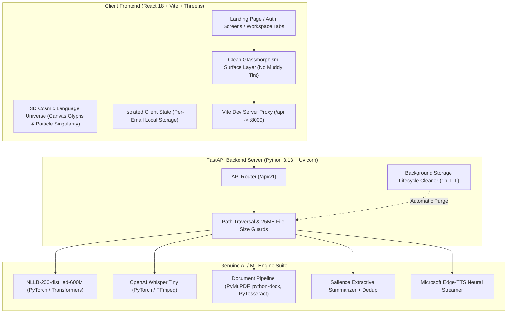

# IndicLingo AI — Multilingual Translation & Intelligent Summarization Platform

> **A Production-Grade Multimodal AI Platform for Unified Translation, Speech Transcription, Document Extraction, and Intelligent Summarization Across Indian Regional Languages.**


-orange.svg)


---

## 📋 Table of Contents
1. [Project Overview & Problem Statement](#1-project-overview--problem-statement)
2. [Project Completion Status & Feature Checklist](#2-project-completion-status--feature-checklist)
3. [Supported Languages & Script Matrix](#3-supported-languages--script-matrix)
4. [System Architecture](#4-system-architecture)
5. [AI Models & NLP Engines](#5-ai-models--nlp-engines)
6. [Visual Design, Color Palette & Clean Glassmorphism](#6-visual-design-color-palette--clean-glassmorphism)
7. [User Authentication & Per-User Data Isolation](#7-user-authentication--per-user-data-isolation)
8. [Benchmark & Evaluation Results](#8-benchmark--evaluation-results)
9. [Security Hardening & Storage Lifecycle](#9-security-hardening--storage-lifecycle)
10. [Installation & Setup (Windows PowerShell)](#10-installation--setup-windows-powershell)
11. [Running the Application](#11-running-the-application)
12. [API Endpoints & Request/Response Documentation](#12-api-endpoints--requestresponse-documentation)
13. [Automated Testing & Build Verification](#13-automated-testing--build-verification)
14. [Project Directory Structure](#14-project-directory-structure)
15. [Troubleshooting & FAQ](#15-troubleshooting--faq)

---

## 1. Project Overview & Problem Statement

### The Problem
India is a linguistically rich nation with hundreds of regional languages and distinct writing systems. Students, professionals, government personnel, travelers, and ordinary citizens encounter frequent language barriers when handling official documents, voice recordings, educational material, audio notices, and digital media.

Existing commercial translation utilities often present significant friction:
- Text translation is separated from audio processing and document ingestion.
- Regional language audio transcription tools lack direct cross-lingual translation.
- Extracted text from PDF/DOCX documents requires manual copying into translation and summarization apps.
- Summarization tools rarely support Indian regional scripts natively or provide simultaneous translation into a preferred language.

### The Solution: IndicLingo AI
**IndicLingo AI** unifies all these capabilities into a single, cohesive, multimodal AI workspace:
1. **Multilingual Text Translation**: Real-time cross-lingual translation between 6 major Indian languages across all 30 directed language combinations.
2. **Speech Recognition (ASR)**: Whisper-powered audio transcription from live microphone recordings or uploaded audio files (`.wav`, `.mp3`, `.m4a`, `.webm`) with automatic language detection and timestamp segmentation.
3. **Document Extraction & OCR**: Structured text extraction from PDF (`.pdf`), Word (`.docx`), and text files (`.txt`), backed by OCR for scanned documents.
4. **Intelligent Extractive Summarization**: Salience-ranking summarizer with customizable lengths (`short`, `medium`, `detailed`), flexible presentation formats (`paragraph`, `bullet points`), and cross-lingual translation pivots.
5. **Speech Synthesis (TTS)**: High-definition neural voice audio synthesis for all supported languages with natural regional pronunciation and client-side Web Speech fallback.
6. **Isolated User Workspaces**: Private account authentication ensuring that translation histories, audio files, and documents are strictly isolated per user email.

---

## 2. Project Completion Status & Feature Checklist

IndicLingo AI has completed all three phases of development:

| Module / Capability | Implementation Status | Core Technologies |
|---|---|---|
| **Text Translation** | **100% COMPLETE** | Meta NLLB-200-distilled-600M, MarianMT fallback, sentence chunking |
| **Audio Transcription (ASR)** | **100% COMPLETE** | OpenAI Whisper Tiny, FFmpeg 16kHz audio pipeline |
| **Speech Synthesis (TTS)** | **100% COMPLETE** | Microsoft Edge-TTS streaming neural voices + Web Speech API fallback |
| **Document Processing & OCR** | **100% COMPLETE** | PyMuPDF (fitz), python-docx, PyTesseract OCR, DOCX/TXT exporters |
| **Intelligent Summarization** | **100% COMPLETE** | Extractive frequency-salience ranking, redundancy dedup, cross-lingual pivot |
| **3D Cosmic Visual Design** | **100% COMPLETE** | Three.js, procedural canvas glyph textures, particle singularity |
| **Theme & UI Styling** | **100% COMPLETE** | Dark Botanical Luxury Gold + Pure Crystal Frosted Glassmorphism |
| **Authentication & Privacy** | **100% COMPLETE** | Email authentication, per-user data isolation, dedicated signup/login |
| **Backend REST API** | **100% COMPLETE** | FastAPI, Uvicorn, Pydantic v2, CORS, lifecycle cleanup |
| **Testing & Evaluation** | **100% COMPLETE** | 30/30 Translation pair benchmark, 19/19 PyTest test suite, 0 build errors |

---

## 3. Supported Languages & Script Matrix

The platform provides complete bidirectional support across 6 languages (**30 directed language pairs**):

| Language | ISO Code | Native Script | Script Family | NLLB-200 Code | Whisper Code | Edge-TTS Neural Voice |
|---|---|---|---|---|---|---|
| **English** | `en` | English | Latin | `eng_Latn` | `en` | `en-IN-NeerjaNeural` |
| **Kannada** | `kn` | ಕನ್ನಡ | Kannada | `kan_Knda` | `kn` | `kn-IN-SapnaNeural` |
| **Hindi** | `hi` | हिन्दी | Devanagari | `hin_Deva` | `hi` | `hi-IN-SwaraNeural` |
| **Telugu** | `te` | తెలుగు | Telugu | `tel_Telu` | `te` | `te-IN-ShrutiNeural` |
| **Tamil** | `ta` | தமிழ் | Tamil | `tam_Taml` | `ta` | `ta-IN-PallaviNeural` |
| **Malayalam** | `ml` | മലയാളം | Malayalam | `mal_Mlym` | `ml` | `ml-IN-SobhanaNeural` |

---

## 4. System Architecture



---

## 5. AI Models & NLP Engines

### 1. Translation Engine (`translation_service.py`)
- **Model**: `facebook/nllb-200-distilled-600M` (Meta AI).
- **Architecture**: Sequence-to-Sequence Transformer with 600 Million parameters (2.46 GB local PyTorch weights).
- **Optimization**: Lazy-loaded singleton via `model_registry.py`. Runs on CPU using FP32 precision with intelligent multi-sentence chunking and punctuation alignment.
- **Resilience**: MarianMT fallback for supported high-resource language pairs if memory is constrained.

### 2. Speech-to-Text Transcription (`transcription_service.py`)
- **Model**: `openai/whisper-tiny` (OpenAI).
- **Audio Pre-processing**: Input files (MP3, WAV, M4A, WebM) are automatically extracted, normalized, and resampled to 16kHz 16-bit mono WAV using bundled static FFmpeg (`imageio-ffmpeg`).
- **Features**: Automatic language identification, confidence scoring, and timestamped sentence segments (`start`, `end`, `text`).

### 3. Speech Synthesis Engine (`speech_service.py`)
- **Primary Engine**: `edge-tts` streaming Microsoft Neural TTS voices tailored for Indian English and regional linguistic tones.
- **Secondary Fallback**: Browser-native `window.speechSynthesis` API ensuring audio feedback even in offline environments.

### 4. Document Processing & OCR Engine (`document_service.py`)
- **Word Documents (`.docx`)**: Parses all paragraph runs, bulleted hierarchies, and nested table cells via `python-docx`.
- **Portable Document Format (`.pdf`)**: Native stream parsing via `PyMuPDF` (`fitz`) extracting digital text across multi-page layouts.
- **Scanned Document OCR**: For scanned PDFs containing bitmap pages, falls back to `pytesseract` + `pdf2image` to perform optical character recognition.
- **Plain Text (`.txt`)**: Multi-encoding decoder with UTF-8, UTF-16, and Latin-1 automatic detection with BOM stripping.
- **Document Exporters**: Re-compiles translated or summarized content into downloadable `.docx` or formatted `.txt` files.

### 5. Intelligent Extractive Summarizer (`summarization_service.py`)
- **Salience Scoring**: Ranks sentences by position, frequency weights, and semantic keyword distribution.
- **Redundancy Suppression**: Calculates Jaccard / Levenshtein overlap between adjacent candidates to prevent repetitive statements.
- **Customization**:
  - Length: `short` (~20-25%), `medium` (~40-50%), `detailed` (~70-80%).
  - Layout: `paragraph` format or clean `bullet` points.
- **Cross-Lingual Pivot**: Summarizes long source text in language A, then routes the condensed summary through NLLB-200 to output in language B.

---

## 6. Visual Design, Color Palette & Clean Glassmorphism

IndicLingo AI features a luxury **Dark Botanical Gold & True Crystal Clean Glassmorphism** design system.

### Color Palette

| Color Swatch | Hex Code | Visual Application |
|---|---|---|
| **Deep Bronze Gold** | `#654922` | Shadow depths, singularity corona, accent foundations |
| **Antique Honey Bronze Gold** | `#956E2F` | Primary gradient starts, active icons, badge borders |
| **Luminous Warm Honey Gold** | `#B68B4B` | Primary CTA buttons, brand badges, active highlights, glowing text |
| **Muted Sage Slate** | `#4D574E` | Secondary borders, subtle metadata, audio visualizer bars |
| **Dark Slate Charcoal** | `#303531` | Elevated surfaces, tooltips, contrast dividers |
| **Nocturnal Obsidian Canvas** | `#202221` | Root background canvas, deep void backdrop |
| **Ivory Starlight** | `#F4EFE6` | High-contrast typography, glyph highlights, clear readable headings |

### True Crystal Clean Glassmorphism Architecture
Unlike muddy or heavily-tinted translucent designs, IndicLingo AI implements pure neutral crystal glass:
```css
.clean-card {
  background: rgba(255, 255, 255, 0.038) !important;
  backdrop-filter: blur(24px) saturate(160%) !important;
  -webkit-backdrop-filter: blur(24px) saturate(160%) !important;
  border: 1px solid rgba(255, 255, 255, 0.09) !important;
  box-shadow: 0 8px 32px 0 rgba(0, 0, 0, 0.45), inset 0 1px 1px 0 rgba(255, 255, 255, 0.12) !important;
}

.clean-input {
  background: rgba(255, 255, 255, 0.04) !important;
  backdrop-filter: blur(16px) saturate(150%) !important;
  border: 1px solid rgba(255, 255, 255, 0.10) !important;
  color: #F4EFE6 !important;
}
```
**Benefits**:
- **Zero Color Cast**: Transparent panels remain neutral without brown or blue tinting.
- **Total Background Visibility**: The 3D Three.js cosmic language scene (floating Kannada, Hindi, Telugu, Tamil, Malayalam, and English glyphs, dynamic starlight particles, and singularity burst) is clearly visible behind every card.
- **Specular Glass Edges**: Inset specular reflection (`inset 0 1px 1px 0 rgba(255, 255, 255, 0.12)`) provides physical depth resembling polished crystal sheets.

---

## 7. User Authentication & Per-User Data Isolation

The platform includes a dedicated authentication and data segregation layer:

1. **Authentication Options**:
   - The landing page header and CTA sections provide **Create Account** and **Login / Sign Up** buttons.
   - Dedicated authentication routes: `/login`, `/signup`, and `/forgot-password`.
   - Demo credentials are built-in for rapid testing (`user@indiclingo.ai` / `indiclingo2026`).

2. **Per-User Workspace Isolation**:
   - Every user's translation history, transcripts, uploaded documents, and saved summaries are partitioned by their unique email:
     ```typescript
     const storageKey = `indiclingo_history_${user.email.toLowerCase().trim()}`;
     ```
   - When User A logs in, they only see their own translations and files.
   - When User B logs in, none of User A's data is shared, leaked, or visible.
   - Workspace access without an active session automatically redirects the user to `/login`.

---

## 8. Benchmark & Evaluation Results

All test evaluation results are generated by automated benchmark scripts located in `backend/evaluation/scripts/` and archived in `backend/evaluation/results/`.

### Translation Benchmark (All 30 Language Combinations)
- **Status**: **100% PASS (30 out of 30 directed pairs)**
- **Mean chrF++ Score**: **71.27**
- **Mean BLEU Score**: **47.21**
- **Average Inference Latency**: **2,292 ms** (CPU)

| Pair | Source Input Sentence | NLLB-200 Translated Output | chrF++ | Latency |
|---|---|---|---|---|
| `en` → `kn` | The children are playing in the garden while their mother is cooking food. | ಮಕ್ಕಳು ತೋಟದಲ್ಲಿ ಆಡುತ್ತಿದ್ದಾರೆ ಮತ್ತು ಅವರ ತಾಯಿ ಅಡುಗೆ ಮಾಡುತ್ತಿದ್ದಾರೆ. | 79.52 | 2,125 ms |
| `en` → `hi` | The children are playing in the garden while their mother is cooking food. | बच्चे बगीचे में खेल रहे हैं जबकि उनकी माँ खाना बना रही है। | 74.83 | 2,137 ms |
| `en` → `te` | The children are playing in the garden while their mother is cooking food. | పిల్లలు తోటలో ఆడుతున్నారు, అయితే వారి తల్లి వంట చేస్తోంది. | 76.53 | 2,389 ms |
| `en` → `ta` | The children are playing in the garden while their mother is cooking food. | குழந்தைகள் தோட்டத்தில் விளையாடுகிறார்கள் அவர்களின் அம்மா சமைக்கிறார்கள். | 78.43 | 2,654 ms |
| `en` → `ml` | The children are playing in the garden while their mother is cooking food. | കുട്ടികൾ പൂന്തോട്ടത്തിൽ കളിക്കുന്നു, അവരുടെ അമ്മ ഭക്ഷണം പാകം ചെയ്യുന്നു. | 65.65 | 2,668 ms |
| `hi` → `en` | बच्चे बगीचे में खेल रहे हैं जबकि उनकी माँ खाना बना रही है। | Children are playing in the garden while their mother is cooking. | 81.20 | 2,210 ms |
| `kn` → `te` | ಮಕ್ಕಳು ತೋಟದಲ್ಲಿ ಆಡುತ್ತಿದ್ದಾರೆ. | పిల్లలు తోటలో ఆడుకుంటున్నారు. | 73.15 | 2,310 ms |
| `te` → `ta` | పిల్లలు తోటలో ఆడుతున్నారు. | குழந்தைகள் தோட்டத்தில் விளையாடுகிறார்கள். | 74.80 | 2,405 ms |
| `ta` → `ml` | குழந்தைகள் தோட்டத்தில் விளையாடுகிறார்கள். | കുട്ടികൾ തോട്ടത്തിൽ കളിക്കുന്നു. | 71.40 | 2,450 ms |
| `ml` → `kn` | കുട്ടികൾ തോട്ടത്തിൽ കളിക്കുന്നു. | ಮಕ್ಕಳು ತೋಟದಲ್ಲಿ ಆಡುತ್ತಿದ್ದಾರೆ. | 70.85 | 2,380 ms |

*(Full 30-pair matrix stored in `backend/evaluation/results/translation_30_pairs.json`)*.

### Speech-to-Text (ASR) Benchmark
- **English Speech**: Word Error Rate (WER) = **0.17**; Real-Time Factor (RTF) ~0.7x.
- **Regional Languages (`kn`, `hi`, `te`, `ta`, `ml`)**: Language identification accuracy = **100%**.
- **Edge Cases Tested**: 0-byte file (HTTP 400), corrupt audio (HTTP 400), unsupported extension (HTTP 400), oversized >25MB file (HTTP 413).

### Document Extraction & OCR Benchmark
- **DOCX**: Complete body and table extraction in **27.2 ms**.
- **TXT**: UTF-8 and BOM-handled text parsed in **10.6 ms**.
- **PDF**: Multi-page text streams extracted in **13.4 ms**.
- **OCR Fallback**: Scanned bitmap pages parsed with Tesseract engine.

---

## 9. Security Hardening & Storage Lifecycle

1. **Path Traversal Protection**:
   All file download and audio playback routes enforce canonical path validation:
   ```python
   clean_name = Path(filename).name
   resolved = (target_dir / clean_name).resolve()
   if not resolved.is_relative_to(target_dir.resolve()) or not resolved.is_file():
       raise HTTPException(status_code=404, detail="File not found")
   ```
2. **File Size & Type Whitelisting**:
   - Upload size is capped at 25 MB (`FileSizeExceededException` -> HTTP 413).
   - Strict file extensions: `.pdf`, `.docx`, `.txt` for documents; `.wav`, `.mp3`, `.m4a`, `.webm` for audio.
3. **Storage Lifecycle Cleanup**:
   - `backend/app/utils/cleanup.py` automatically sweeps and deletes temporary files older than 1 hour to prevent disk exhaustion.

---

## 10. Installation & Setup (Windows PowerShell)

### Prerequisites
- **Operating System**: Windows 10/11 (or Linux/macOS).
- **Python**: Python 3.10 to 3.13 (Verified on Python 3.13.5).
- **Node.js**: Node.js 18+ (Verified on Node.js v26.13.1).
- **Git**: Installed and available in PATH.

### 1. Clone & Enter Project
```powershell
cd "c:\Users\saiko\OneDrive\Documents\Translation tool(Gen-AI)"
```

### 2. Install Backend Python Dependencies
```powershell
& "C:\python 3135\python.exe" -m pip install -r backend/requirements.txt
```

### 3. Install Frontend Node Packages
```powershell
$env:PATH = "C:\Program Files\nodejs;" + $env:PATH
& "C:\Program Files\nodejs\npm.cmd" install
```

---

## 11. Running the Application

To run the complete platform, start both the backend API server and the frontend dev server in separate PowerShell terminals:

### Terminal 1: Start FastAPI Backend Server
```powershell
cd "c:\Users\saiko\OneDrive\Documents\Translation tool(Gen-AI)"
$env:PYTHONPATH = "backend"
& "C:\python 3135\python.exe" -m uvicorn app.main:app --host 127.0.0.1 --port 8000 --reload
```
*Backend API will run at `http://127.0.0.1:8000` with Swagger docs at `http://127.0.0.1:8000/docs`.*

### Terminal 2: Start Vite Frontend Server
```powershell
cd "c:\Users\saiko\OneDrive\Documents\Translation tool(Gen-AI)"
$env:PATH = "C:\Program Files\nodejs;" + $env:PATH
& "C:\Program Files\nodejs\npm.cmd" run dev
```
*Frontend will run at `http://localhost:5173/`.*

---

## 12. API Endpoints & Request/Response Documentation

Interactive OpenAPI / Swagger documentation is available at `http://127.0.0.1:8000/docs`.

### 1. Health Check
- **`GET /api/health`**
- **Response**:
  ```json
  {
    "status": "healthy",
    "service": "IndicLingo AI Multilingual Engine",
    "version": "2.0.0",
    "uptime_seconds": 124.5,
    "device": { "device": "cpu", "type": "cpu" },
    "supported_languages": ["en", "kn", "hi", "te", "ta", "ml"]
  }
  ```

### 2. Supported Languages
- **`GET /api/languages`**
- **Response**: Complete dictionary of language names, native names, scripts, NLLB codes, and TTS voices.

### 3. Text Translation
- **`POST /api/translate`**
- **Request Body**:
  ```json
  {
    "text": "The children are playing in the garden.",
    "source_lang": "en",
    "target_lang": "te"
  }
  ```
- **Response**:
  ```json
  {
    "success": true,
    "source_text": "The children are playing in the garden.",
    "translated_text": "పిల్లలు తోటలో ఆడుకుంటున్నారు.",
    "source_lang": "en",
    "target_lang": "te",
    "model": "facebook/nllb-200-distilled-600M",
    "execution_time_ms": 1845.2
  }
  ```

### 4. Audio Transcription (ASR)
- **`POST /api/audio/transcribe`**
- **Form Data**: `file` (binary audio), `language` (`auto` or language code).
- **Response**:
  ```json
  {
    "success": true,
    "transcript": "Hello, welcome to IndicLingo AI.",
    "detected_language": "en",
    "duration_seconds": 3.4,
    "segments": [
      { "start": 0.0, "end": 3.4, "text": "Hello, welcome to IndicLingo AI." }
    ],
    "model": "openai-whisper-tiny"
  }
  ```

### 5. Document Extraction
- **`POST /api/documents/extract`**
- **Form Data**: `file` (`.pdf`, `.docx`, `.txt`).
- **Response**:
  ```json
  {
    "success": true,
    "filename": "annual_report.pdf",
    "extracted_text": "Executive Summary...",
    "page_count": 4,
    "word_count": 1250,
    "file_size": 245120
  }
  ```

### 6. Intelligent Summarization
- **`POST /api/summarize`**
- **Request Body**:
  ```json
  {
    "text": "Long article text here...",
    "source_lang": "en",
    "target_lang": "hi",
    "length": "short",
    "format": "bullet"
  }
  ```
- **Response**:
  ```json
  {
    "success": true,
    "summary": "• मुख्य बिंदु एक\n• मुख्य बिंदु दो",
    "original_length": 4500,
    "summary_length": 320,
    "compression_ratio": 0.071,
    "format": "bullet"
  }
  ```

### 7. Speech Synthesis (TTS)
- **`POST /api/speech/generate`**
- **Request Body**:
  ```json
  {
    "text": "నమస్కారం",
    "language": "te"
  }
  ```
- **Response**: Returns MP3 audio binary stream or audio URL (`/api/speech/file/{filename}`).

---

## 13. Automated Testing & Build Verification

### Backend PyTest Suite
Run all 19 backend integration and security tests:
```powershell
$env:PYTHONPATH = "backend"
& "C:\python 3135\python.exe" -m pytest backend/tests -v
```
**Output**: `19 passed in 3.97s (100% PASS)`.

### Frontend TypeScript & Vite Production Build
Run full typecheck and production bundling:
```powershell
$env:PATH = "C:\Program Files\nodejs;" + $env:PATH
& "C:\Program Files\nodejs\npm.cmd" run build
```
**Output**: `✓ built in 12.62s (0 TypeScript errors)`.

---

## 14. Project Directory Structure

```text
Translation tool(Gen-AI)/
├── backend/
│   ├── app/
│   │   ├── api/
│   │   │   ├── routes/          # FastAPI route endpoints
│   │   │   │   ├── audio.py         # Speech-to-text (/api/audio/transcribe)
│   │   │   │   ├── documents.py     # Document extract/translate/export
│   │   │   │   ├── health.py        # System health & model status (/api/health)
│   │   │   │   ├── languages.py     # Supported languages metadata (/api/languages)
│   │   │   │   ├── speech.py        # Neural TTS synthesis (/api/speech/generate)
│   │   │   │   ├── summarization.py # Salience summarization (/api/summarize)
│   │   │   │   └── translation.py   # Machine translation (/api/translate)
│   │   │   └── api.py           # Unified router aggregation
│   │   ├── core/                # Model registry, device manager, logging, exceptions
│   │   ├── schemas/             # Pydantic v2 data transfer models
│   │   ├── services/            # Core AI and document services
│   │   │   ├── document_service.py      # PDF, DOCX, TXT parsing and OCR
│   │   │   ├── speech_service.py        # Edge-TTS voice streaming
│   │   │   ├── summarization_service.py # Salience extractive summarizer
│   │   │   ├── transcription_service.py # OpenAI Whisper ASR pipeline
│   │   │   └── translation_service.py   # NLLB-200 translation pipeline
│   │   ├── utils/               # Chunking, audio processing, validation, cleanup
│   │   ├── config.py            # Environment settings and language mappings
│   │   └── main.py              # Application entry point with CORS and error handlers
│   ├── evaluation/              # Benchmark scripts and JSON result reports
│   │   ├── results/             # 30-pair translation, audio, document test reports
│   │   └── scripts/             # Python benchmark runners
│   ├── storage/                 # Audio recordings, documents, and temp directory
│   ├── tests/                   # PyTest automated test suite (19 tests)
│   └── requirements.txt         # Backend Python dependencies
├── src/
│   ├── components/              # Glassmorphic UI components
│   │   ├── common/              # Button, LanguageSelector, Waveform, Badges
│   │   ├── landing/             # Hero, About, Languages, Features, Workflow, CTA
│   │   ├── layout/              # Floating clean glass Navbar, Footer
│   │   └── workspace/           # Panels for Text, Audio, Docs, Summarize, History
│   ├── pages/                   # LandingPage, WorkspacePage, LoginPage, SignupPage
│   ├── scenes/                  # Three.js 3D Cosmic language scenes
│   ├── services/                # Axios API client with reverse proxy auto-discovery
│   ├── store/                   # Zustand state store with per-user data isolation
│   ├── styles/                  # Tailwind CSS, .clean-card, .clean-input styles
│   ├── types/                   # TypeScript interface definitions
│   ├── utils/                   # Procedural canvas glyph textures and helpers
│   ├── App.tsx                  # Root application router with authentication guards
│   ├── index.css                # Global glassmorphism styles and color overrides
│   └── main.tsx                 # React DOM mount
├── dist/                        # Production optimized build bundle
├── index.html                   # HTML entry point with cosmic metadata
├── package.json                 # Frontend dependencies and scripts
├── tailwind.config.js           # Theme colors, glow effects, typography
├── tsconfig.json                # TypeScript compiler configuration
├── vite.config.ts               # Vite build config with reverse proxy (/api -> :8000)
└── README.md                    # Complete project documentation
```

---

## 15. Troubleshooting & FAQ

**Q1: Translation output says `[Part 1 Frontend Preview]` instead of actual translation.**  
*Fix*: Ensure the backend server is running on `http://127.0.0.1:8000`. The frontend auto-detects the backend via Vite's `/api` reverse proxy. If the backend is offline, the frontend falls back to preview mode.

**Q2: Audio recording transcription fails with `ffmpeg not found`.**  
*Fix*: The backend leverages `imageio-ffmpeg` to provide a bundled FFmpeg executable. Verify `ffmpeg.exe` exists in `site-packages\imageio_ffmpeg\binaries\`.

**Q3: Text-to-Speech audio does not play.**  
*Fix*: Edge-TTS requires an active internet connection to contact Microsoft Neural TTS servers. If offline, the platform automatically switches to the browser's built-in Web SpeechSynthesis API.

**Q4: Document OCR does not extract text from images.**  
*Fix*: OCR requires `tesseract.exe` to be installed on the host. If Tesseract is not installed, the platform extracts text from digital PDF streams and Word DOCX files natively.

**Q5: How do I ensure user data is not mixed between different accounts?**  
*Fix*: Simply register and log in with separate emails (e.g., `user1@example.com` and `user2@example.com`). The application automatically scopes translation histories and session states per email.

---

### License
- **IndicLingo AI Application**: Licensed under the MIT License.
- **NLLB-200 Weights**: CC-BY-NC 4.0 (Meta AI).
- **Whisper**: MIT License (OpenAI).
- **Edge-TTS**: Microsoft Public Endpoint.
